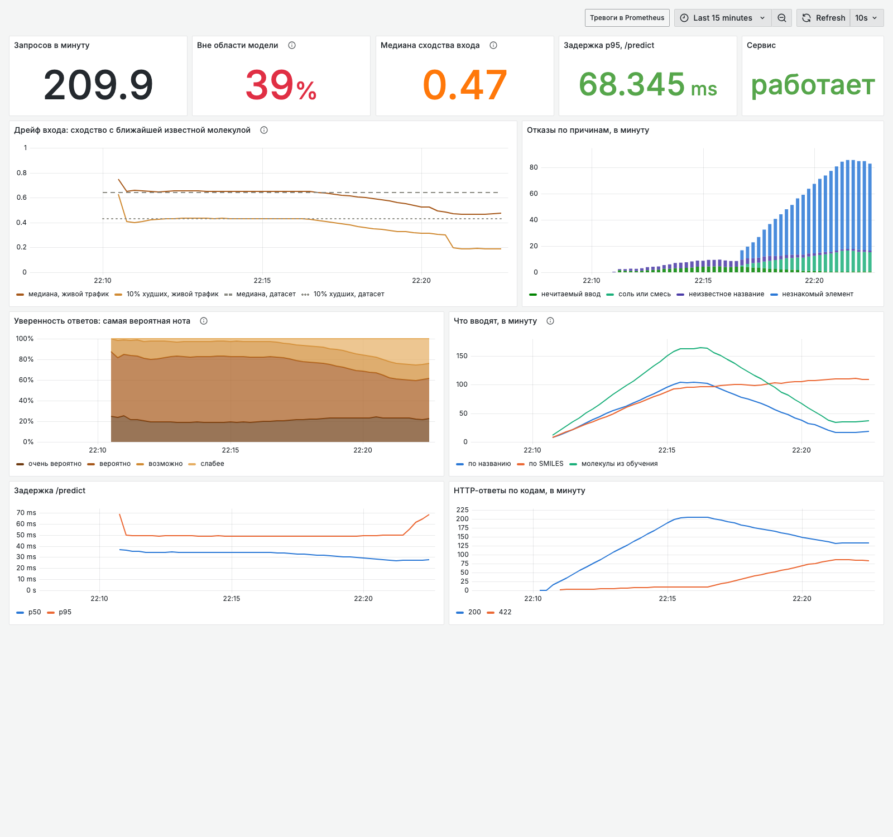

# sillage

> _Sillage_ — шлейф, след аромата в воздухе. ML-project (classification, GNN, NLP).

Открытая система, связывающая три уровня парфюмерии: **молекула → смесь → человеческое восприятие**. Снизу — GNN, предсказывающая запах по структуре. В середине — модель агрегации смеси и предсказание перцептивного расстояния. Сверху — реальные парфюмы с их нотами, пирамидами и сотнями тысяч отзывов на 20+ языках. Итог: инструмент, который по составу аромата предсказывает его ольфакторный профиль, эволюцию на коже во времени и похожие ароматы — и проверяет свои предсказания против того, что реально пишут люди.

**Статус:** Фазы 0–1 завершены, идёт продуктовый трек Фазы 2
([дорожная карта](docs/roadmap-product.md)). Модель structure → odour обучена,
откалибрована и отдаётся через веб-интерфейс и HTTP API в Docker-контейнере;
молекулу можно искать по русскому или английскому названию и увидеть на карте
запахов среди 4777 известных; работа сервиса видна на дашборде Grafana. Продуктовый
трек закрыт. Модель — ансамбль графовых нейросетей, отпечатков Моргана и
физико-химических дескрипторов; стереоизомеры она различает.

### Запустить у себя

Нужен только Docker. Образ сам скачает опубликованную модель с
[HF Hub](https://huggingface.co/ykvnkm/sillage-odor-ensemble-v3) и сверит её по
контрольным суммам:

```bash
git clone https://github.com/ykvnkm/sillage.git && cd sillage
docker build -t sillage . && docker run --rm -p 8000:8000 sillage
```

Затем откройте http://localhost:8000. Первая сборка занимает несколько минут.
Публичного адреса пока нет: бесплатный хостинг Docker-приложений на Hugging Face
закрыли в июле 2026, решение о хостинге отложено
([ADR-0015](docs/adr/0015-public-deployment-is-deferred.md)).

Без Docker, из исходников (нужен [`uv`](https://docs.astral.sh/uv/)):

```bash
uv sync                                        # зависимости строго по uv.lock
uv run python scripts/fetch_model.py           # модель с HF Hub (или обучить: scripts/train_model.py, ~40 с)
uv run uvicorn sillage.interfaces.api.app:app  # сайт на http://localhost:8000
```

Из терминала:

```bash
uv run sillage-predict "COc1cc(C=O)ccc1O"      # ванилин
uv run sillage-predict "BrCCCCCC=O" --json     # отказ: брома нет в обучающих данных
curl -X POST localhost:8000/predict -H 'content-type: application/json' \
     -d '{"smiles": "COc1cc(C=O)ccc1O"}'      # HTTP API, документация на /docs
```

Отказ — HTTP 422 с кодом причины, в одной форме для любого отказа
([ADR-0013](docs/adr/0013-http-contract-refusals-are-422.md)). Запрос целиком
занимает около 10 мс на CPU.

### Наблюдаемость

Сервис вместе с Prometheus и Grafana (дашборд дрейфа входа, отказов и уверенности,
тревоги с тестами):

```bash
docker compose -f deploy/observability/compose.yml up --build -d
python3 scripts/simulate_traffic.py      # 8 минут обычного трафика, затем 8 минут сдвига
open http://localhost:3000               # дашборд «sillage»
```



_Трафик синтетический: сначала известные молекулы по названию и SMILES, затем сдвиг —
лекарства, галогенсодержащие растворители и соли. Живая медиана сходства уходит ниже
линии датасета, растёт доля отказов вне области модели
([ADR-0016](docs/adr/0016-observability-is-local-compose-with-tested-alerts.md))._

Ответ — дескрипторы со словом уверенности («очень вероятно» сбывается в 85% случаев),
отдельный список неоткалиброванных меток без чисел, метки экспертов, если молекула
известна, и пять ближайших известных молекул. Вне области определения — отказ с
кодом причины. Model card: [`docs/model-cards/odor-ensemble-v3.md`](docs/model-cards/odor-ensemble-v3.md),
дизайн интерфейса: [`DESIGN.md`](DESIGN.md).

## Архитектура

```
L4  Продукт        API + карта запахов + рекомендер + детектор клонов
L3  Восприятие     ABSA по отзывам: стойкость, шлейф, сезон, "пахнет как"
L2  Мост           нота ↔ парфюмерный материал ↔ молекула (entity linking)
L1  Смеси          агрегация молекулярных эмбеддингов → профиль/расстояние
L0  Молекулы       GNN structure→odor, multilabel, 135 дескрипторов
```

Слои развязаны намеренно: если самый рискованный L2 не взлетит, рабочими
остаются L0, L1 и продукт поверх нот без молекул.

## Data provenance

**Сырые данные не попадают в репозиторий.** В git лежат только описания
источников и контрольные суммы; публикуются исключительно производные артефакты
(веса, эмбеддинги, агрегаты) с явным указанием источника и условий использования.

Каждый источник описан в [`src/sillage/data/sources.py`](src/sillage/data/sources.py)
и запинен на неизменяемую ревизию плюс `sha256`. Таблица ниже порождается из
реестра командой `uv run sillage-data provenance`; тест следит, чтобы она не
разошлась с кодом.

<!-- BEGIN PROVENANCE -->
| Source | Licence | Redistribution | Description |
| --- | --- | --- | --- |
| [openpom-curated-gs-lf](https://github.com/BioMachineLearning/openpom) | MIT | allowed | Curated Goodscents/Leffingwell merge: 4983 molecules, multilabel odours. |
| [pyrfume-goodscents-behavior](https://github.com/pyrfume/pyrfume-data/tree/8054ea98ed675005ec10e67359902f500e4911b0/goodscents) | no licence file; source terms apply | derived-only | Goodscents: free-text odour descriptors. |
| [pyrfume-goodscents-molecules](https://github.com/pyrfume/pyrfume-data/tree/8054ea98ed675005ec10e67359902f500e4911b0/goodscents) | no licence file; source terms apply | derived-only | Goodscents: isomeric structures by PubChem id. |
| [pyrfume-goodscents-stimuli](https://github.com/pyrfume/pyrfume-data/tree/8054ea98ed675005ec10e67359902f500e4911b0/goodscents) | no licence file; source terms apply | derived-only | Goodscents: record to PubChem id. |
| [pyrfume-leffingwell-behavior](https://github.com/pyrfume/pyrfume-data/tree/8054ea98ed675005ec10e67359902f500e4911b0/leffingwell) | no licence file; source terms apply | derived-only | Leffingwell: 113 binary odour labels. |
| [pyrfume-leffingwell-molecules](https://github.com/pyrfume/pyrfume-data/tree/8054ea98ed675005ec10e67359902f500e4911b0/leffingwell) | no licence file; source terms apply | derived-only | Leffingwell: structures by stimulus id. |
| [pyrfume-leffingwell-stimuli](https://github.com/pyrfume/pyrfume-data/tree/8054ea98ed675005ec10e67359902f500e4911b0/leffingwell) | no licence file; source terms apply | derived-only | Leffingwell: stimulus to PubChem id. |
<!-- END PROVENANCE -->

Названия молекул для поиска (`names.json` рядом с весами) собирает
`scripts/build_names.py`: английские названия и синонимы — из
[PubChem](https://pubchem.ncbi.nlm.nih.gov/) (public domain), русские — из
[Wikidata](https://www.wikidata.org/) (CC0).

Колонка *Redistribution* — не украшение, а рабочее ограничение: `allowed` можно
публиковать как есть, `derived-only` разрешает публиковать только производные
артефакты, `forbidden` не допускает и этого.

Загрузка всех источников:

```bash
uv run sillage-data list      # что зарегистрировано и запинено ли
uv run sillage-data fetch     # скачать в data/raw/ и сверить контрольные суммы
```

### Контракты

Контрольная сумма отвечает на вопрос «те ли это байты», но не на вопрос «валидны
ли эти данные». Второе описано схемами pandera в
[`schemas.py`](src/sillage/data/schemas.py) и проверяется **при загрузке**, а не
отдельной командой ([ADR-0004](docs/adr/0004-data-contracts-are-checked-on-load.md)):

```python
from sillage.data.loaders import load_curated_openpom

df = load_curated_openpom()  # 4983 × 140, иначе исключение с указанием строки
```

## Результаты

Фаза 1, бейзлайн structure → odour. Метрика — macro average precision, потому что
она единственная имеет честно низкий пол на этих данных
([журнал E-004](docs/journal/experiments.md)). Полные таблицы — в
[`results/`](results/).

| Модель | Признаки | Стратифицированный | Скаффолд |
| --- | --- | --- | --- |
| градиентный бустинг | фингерпринты + дескрипторы (2264) | **0.3485** | — |
| логрег, поблочное масштабирование | фингерпринты + дескрипторы (2264) | **0.3420 ± 0.0126** | **0.2925** |
| градиентный бустинг | только дескрипторы (216) | 0.3396 ± 0.0111 | 0.2825 |
| логрег | только дескрипторы (216) | 0.3055 ± 0.0149 | 0.2683 |
| _пол:_ предсказание по частотам меток | — | _0.0349 ± 0.0015_ | _0.0365_ |

Верхние строки неразличимы в пределах разброса по сидам: **потолок задан
представлением молекулы, а не моделью** ([E-006](docs/journal/experiments.md)).
Скаффолд-сплит измеряет 128 меток из 138 — у остальных нет положительных примеров
в тесте, и метрика для них не определена, а не равна нулю
([ADR-0007](docs/adr/0007-two-splits-reported-side-by-side.md)).

```bash
uv run python scripts/run_baseline.py --models logreg --seeds 0 1 2
```

## Исследование

| Блокнот | О чём |
| --- | --- |
| [01 — разведочный анализ](notebooks/01_eda_odor_descriptors.ipynb) | молекулы и запахи: разреженность, дисбаланс, ко-встречаемость дескрипторов, структуры глазами |
| [02 — анализ ошибок бейзлайна](notebooks/02_baseline_error_analysis.ipynb) | качество против частоты дескриптора, 20 худших предсказаний, уверенные ошибки вне распределения |

Блокноты хранятся вместе с выводом и предназначены для чтения прямо на GitHub
([ADR-0005](docs/adr/0005-notebooks-keep-their-outputs.md)).

```bash
uv run jupyter lab      # ядро — окружение проекта, отдельно настраивать не нужно
```

## Разработка

Единственное требование — [`uv`](https://docs.astral.sh/uv/). Интерпретатор
ставить не нужно: нужную версию Python `uv` скачает сам согласно
`.python-version`.

```bash
curl -LsSf https://astral.sh/uv/install.sh | sh   # официальный установщик
brew install uv                                   # или Homebrew
pipx install uv                                   # или pipx
```

`pip install uv` — тоже рабочий способ и стандартная практика в Docker и CI, где
интерпретатор фиксирован. Единственный случай, когда он подводит, — установка
внутрь версии, управляемой `pyenv` или `conda`: при переключении версии Python
менеджер окружений оказывается внутри окружения, которым управляет, и теряется.
На такой машине надёжнее ставить `uv` отдельным бинарником.

```bash
git clone https://github.com/ykvnkm/sillage.git && cd sillage
uv sync                    # создаст .venv, поставит зависимости строго по uv.lock
uv run pre-commit install  # включит хуки (git-хуки не клонируются, нужно один раз)
uv run pytest              # тесты должны быть зелёными сразу после клонирования
```

Проверки:

```bash
uv run ruff format .      # форматирование
uv run ruff check --fix . # линтер
uv run pytest             # тесты
```

`pyproject.toml` описывает намерение (какие зависимости нужны), `uv.lock` —
точный воспроизводимый результат его разрешения, с хешами и по всем платформам.
Оба файла коммитятся; обновление зависимостей должно быть видимым коммитом.

## Лицензия

Будет определена до первой публикации артефактов.
